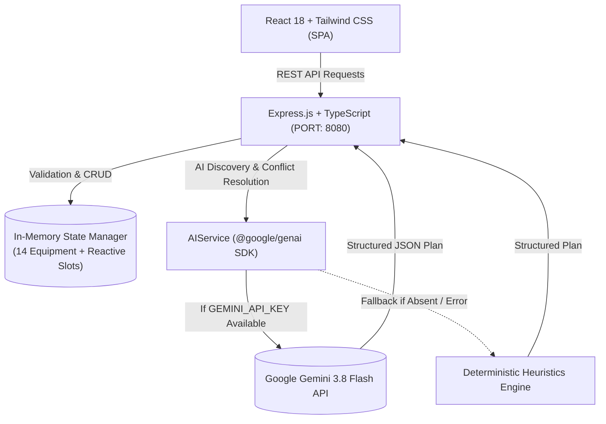

# LabLink 🔬⚡
> **Production-Ready, GenAI-Powered Campus Laboratory Resource-Sharing Platform**
> Built with React (Vite + TypeScript + Tailwind CSS) & Node.js (Express + TypeScript) in a single-container monorepo ready for Google Cloud Run.

[](https://nodejs.org/)
[](https://react.dev/)
[](https://www.typescriptlang.org/)
[](https://ai.google.dev/)
[](https://vitest.dev/)
[](https://cloud.google.com/run)

---

## 🎯 Executive Summary & Problem Alignment

Modern university research is deeply interdisciplinary—robotics teams need high-VRAM AI compute clusters, AI researchers need SLA resin 3D printers for microfluidics, and biomedical teams need high-bandwidth oscilloscopes. However, campus equipment typically sits trapped inside departmental silos, leading to:
- **Low utilization rates** for specialized multi-thousand-dollar instruments.
- **Scheduling deadlocks & conflicts** between competing academic milestones (e.g. imminent Master's thesis deadlines vs routine coursework).
- **Friction in cross-department discovery**, forcing students to resort to word-of-mouth or uncoordinated lab walk-ins.

**LabLink** solves this by uniting **5 core engineering departments** (AI & ML, Computer Science, Electronics & ECE, Mechanical, Robotics) onto a single, real-time resource-sharing platform powered by Google Gemini and a transparent deterministic fallback scheduler.

---

## ✨ Key Capabilities & Hero Features

### 1. ⚡ GenAI Conflict Resolution Engine (Hero Feature)
When two students request overlapping slots on high-demand equipment, traditional schedulers operate on a crude first-come, first-served basis—frequently starving critical milestones. LabLink introduces an **Autonomous Multi-Factor Conflict Engine**:
- Evaluates **Project Deadline Proximity & Urgency** (e.g., critical thesis submission within 24 hours vs homework due in 14 days).
- Evaluates **Requirement Specificity** (e.g., strict hardware dependency on 48GB VRAM or PA-CF carbon filament vs general compute).
- Enforces **Cross-Department Equity** to eliminate departmental bias.
- Analyzes **Alternative Compatible Hardware & Open Slots** (e.g., auto-routing secondary requests to an Apple M3 Max Mac Studio cluster or shifting 3D printing by 4 hours).
- Produces a structured allocation plan with clear **Fairness Justifications** and a **"Apply Recommended Plan Live"** button that updates the database instantly.
- **Pre-Seeded Conflicts for Evaluators**:
  - **Conflict 1 (NVIDIA RTX A6000)**: Priya Sharma (AI & ML, thesis defense in 24 hours) vs Rohan Verma (CS, intro deep learning homework in 14 days).
  - **Conflict 2 (Bambu Lab X1-Carbon 3D Printer)**: Maya Patel (Robotics, Formula Student electric car safety dyno component in 3 days) vs Kevin Chen (Mechanical, hobby decorative casing in 21 days).

### 2. 🔍 GenAI Project Assistant ("Find Equipment with AI")
Students rarely know exact laboratory model numbers. Instead of manual filtering, they type a plain-English research need (e.g., *"I need to train a vision model and deploy it on a drone before Friday"*):
- Powered by the official `@google/genai` Node.js SDK (targeting `gemini-2.5-flash` with cascading fallback to `gemini-2.0-flash`).
- Returns ranked equipment recommendations with compatibility match scores (e.g., 96%), technical justifications, highlighted specs, and suggested usage tips.
- Includes a **"One-Click Book Slot"** button that pre-fills the project reservation modal.

### 3. 🛡️ Safe Deterministic Fallback (Zero Crash Guarantee)
If `GEMINI_API_KEY` is not provided, expired, or rate-limited:
- LabLink automatically switches to its **Smart Scheduler Fallback Engine** (`deterministic-deadline-fairness-v2` and `heuristic-rules-v2`).
- Both AI Equipment Discovery and Conflict Resolution continue to work transparently, returning formatted recommendations with a clear `source: 'smart-scheduler-fallback'` badge.
- **The application never crashes in the absence of an API key.**

### 4. 🎓 Faculty Approval Dashboard & Frictionless Role Switcher
- A persistent top-bar **Role Switcher (Student View / Faculty View)** lets evaluators test both perspectives without login hurdles.
- Faculty can review pending project requests, inspect academic justifications, approve or reject requests with remarks, and resolve conflicts in one click.

### 5. 📊 Real-Time Resource Utilization Analytics
- Overall lab utilization percentage gauge.
- Interdisciplinary cross-department sharing metrics (e.g. 42% cross-department rate).
- Active vs resolved conflicts counter.
- Per-department resource usage breakdown bars.
- AI-driven suggestions for underutilized laboratory assets (e.g., idle microwave spectrum analyzer or thermal imaging camera).
- Real-time audit log timeline capturing scheduling actions.

---

## 🏛️ System Architecture



### Monorepo Organization
```
LabLink/
├── client/                     # Frontend (React 18, Vite, TypeScript, Tailwind CSS)
│   ├── src/
│   │   ├── api/client.ts       # Typed API client with custom error handling
│   │   ├── components/         # Accessible UI components (Navbar, Modals, Cards)
│   │   │   ├── Navbar.tsx
│   │   │   ├── EquipmentCatalog.tsx
│   │   │   ├── EquipmentCard.tsx
│   │   │   ├── BookingModal.tsx
│   │   │   ├── ConflictResolutionCenter.tsx   # Hero Feature UI
│   │   │   ├── FacultyApprovalPortal.tsx
│   │   │   ├── AnalyticsDashboard.tsx
│   │   │   ├── AIProjectAssistantModal.tsx
│   │   │   ├── StudentRequestsView.tsx
│   │   │   └── Toast.tsx
│   │   ├── types/index.ts      # Shared TypeScript interfaces
│   │   ├── App.tsx             # Main application orchestrator
│   │   └── main.tsx            # Entry point
│   ├── vite.config.ts          # Vite build config with /api proxy
│   └── tailwind.config.js
├── server/                     # Backend (Node.js, Express, TypeScript, Vitest)
│   ├── src/
│   │   ├── app.ts              # Express configuration, Helmet, CORS, Rate Limit
│   │   ├── index.ts            # Server entry listening on 0.0.0.0:8080
│   │   ├── data/seed.ts        # 14 realistic items, 2 active conflicts, audit logs
│   │   ├── routes/             # Modular API routes
│   │   │   ├── equipment.ts
│   │   │   ├── requests.ts
│   │   │   ├── conflicts.ts
│   │   │   ├── ai.ts
│   │   │   └── analytics.ts
│   │   ├── schemas/index.ts    # Strict Zod schemas for all request payloads
│   │   ├── services/
│   │   │   ├── aiService.ts    # @google/genai SDK + deterministic fallback
│   │   │   ├── conflictService.ts # Overlap math & conflict resolution
│   │   │   └── store.ts        # In-memory persistent reactive store
│   │   └── tests/
│   │       └── lablink.test.ts # 19 Vitest unit and API integration tests
│   ├── tsconfig.json
│   └── vitest.config.ts
├── Dockerfile                  # Multi-stage production container build
├── .dockerignore
├── .gitignore
├── .env.example
├── package.json                # Root npm workspace orchestration
└── README.md
```

---

## 🔒 Security Practices & Compliance

1. **Zero Secret Leakage**: `GEMINI_API_KEY` is strictly accessed server-side and is never bundled into client assets.
2. **Strict Zod Input Validation**: Every request body undergoes compile-time and runtime validation (checking email format, time ranges, minimum text lengths, and department enums). Invalid requests are rejected with a 400 status.
3. **Defense-in-Depth Middleware**:
   - `helmet`: Hardens HTTP security headers.
   - `cors`: Restricted cross-origin resource sharing policy.
   - `express-rate-limit`: Protects `/api/*` endpoints from abuse (500 requests per 15 minutes per IP).
4. **Sanitized Error Responses**: Internal exception stack traces are never exposed in production JSON responses.

---

## ♿ Accessibility (WCAG AA Compliance)

- **Semantic HTML**: Built with standard landmarks (`<header>`, `<nav>`, `<main>`, `<section>`, and `<dialog>`).
- **Skip Link**: Features a visible keyboard-navigable `"Skip to main content"` link as the first focusable element.
- **Form Association**: Every `<input>`, `<select>`, and `<textarea>` is tied to a unique `<label htmlFor="...">`.
- **Keyboard Navigation**: Interactive cards, modals, and buttons have visible high-contrast focus rings (`focus-visible:outline-2 focus-visible:outline-teal-600`).
- **Live Announcements**: Status banners, conflict warnings, and action toasts leverage `aria-live="polite"` and `role="status"` for screen readers.

---

## 🚀 Getting Started Locally

### Prerequisites
- **Node.js**: v20 or v22+
- **npm**: v10+

### Installation & Environment Setup
```bash
# 1. Clone repository
git clone <repository-url>
cd LabLink

# 2. Install workspace dependencies
npm install

# 3. Configure environment (Optional: add your Gemini API key)
cp .env.example .env
# Edit .env:
# GEMINI_API_KEY=your_gemini_api_key_here
# GEMINI_MODEL=gemini-2.5-flash
```

### Running Automated Tests
Run the complete Vitest and Supertest automated test suite covering slot overlaps, conflict resolution, AI fallbacks, Zod validation, and faculty actions:
```bash
npm test
```
*Expected output: All 19 tests pass in < 1 second.*

### Building for Production
Build both the React client bundle and the TypeScript server:
```bash
npm run build
```

### Starting the Production Server
Start the Express server on port 8080 (which serves both the API and client static assets):
```bash
npm start
```
Then visit `http://localhost:8080` in your browser.

### Running in Development Mode
To run client (Vite on port 5173 with hot reload) and server concurrently:
```bash
npm run dev
```

---

## ☁️ Google Cloud Run Deployment

LabLink is packaged as a single lean container. In production, Express serves the compiled React application directly from `client/dist` and listens on `PORT=8080` bound to `0.0.0.0`.

### 1. Build and Test Container Locally with Docker
```bash
# Build the multi-stage Docker image
docker build -t lablink:latest .

# Run the container locally
docker run -p 8080:8080 -e PORT=8080 -e GEMINI_API_KEY=your_key lablink:latest
```
Visit `http://localhost:8080/api/health` to verify container readiness.

### 2. Deploy Directly to Google Cloud Run
```bash
# Set your Google Cloud project
gcloud config set project YOUR_PROJECT_ID

# Build and submit the container to Google Cloud Artifact Registry / Container Registry
gcloud builds submit --tag gcr.io/YOUR_PROJECT_ID/lablink

# Deploy the container on Google Cloud Run
gcloud run deploy lablink \
  --image gcr.io/YOUR_PROJECT_ID/lablink \
  --platform managed \
  --region us-central1 \
  --allow-unauthenticated \
  --port 8080 \
  --set-env-vars="GEMINI_MODEL=gemini-2.5-flash" \
  --set-secrets="GEMINI_API_KEY=lablink-gemini-key:latest"
```

---

## 📋 Evaluator Quick Tour & Verification Script

1. **Test AI Equipment Discovery**:
   - Open the web application at `http://localhost:8080`.
   - Click **"Find Equipment with AI"** in the top navigation.
   - Click the prompt chip: *"I need to train a vision model and deploy it on a drone before Friday"*.
   - Observe the ranked recommendations (e.g. NVIDIA Jetson Orin Nano / Xilinx FPGA) with match scores and specs.
   - Click **"Book Slot"** on any recommendation to open the prefilled booking modal.

2. **Test Live Conflict Detection**:
   - In the booking modal, select **NVIDIA RTX A6000 Workstation**.
   - Set Date to `2026-11-24`, Start Time `15:00`, End Time `17:00`.
   - Notice the amber alert: *"⚠️ Live Schedule Overlap Detected! Conflicting with Priya Sharma's booking"*.
   - Click the AI-suggested open slot button or submit with the flag to queue for AI resolution.

3. **Test the GenAI Conflict Resolution Engine (Hero Feature)**:
   - Click the **Role Switcher** at the top right to switch to **Faculty View**.
   - Navigate to **"AI Conflict Center"**.
   - Review Conflict #1 (NVIDIA RTX A6000: Urgent Master's Thesis defense vs Undergrad homework).
   - Click **"Resolve Conflict with AI"**.
   - Review the structured fairness plan: Priya Sharma gets priority due to deadline proximity; Rohan Verma is accommodated with the Apple M3 Max Mac Studio cluster.
   - Click **"Apply Recommended Plan Live"**.
   - Notice the schedule updates instantly in real time and appears in the resolved audit history!

4. **Test Faculty Approvals & Lab Analytics**:
   - Switch to **"Faculty Approvals"** to review pending requests and approve/reject with remarks.
   - Navigate to **"Lab Analytics"** to inspect departmental utilization bars, cross-department sharing rates, and underutilized equipment suggestions.
   - Click **"↻ Reset Demo Data"** in the navbar anytime to return to the initial state.

---

## 📄 License
MIT &copy; Campus Research Resource Initiative
